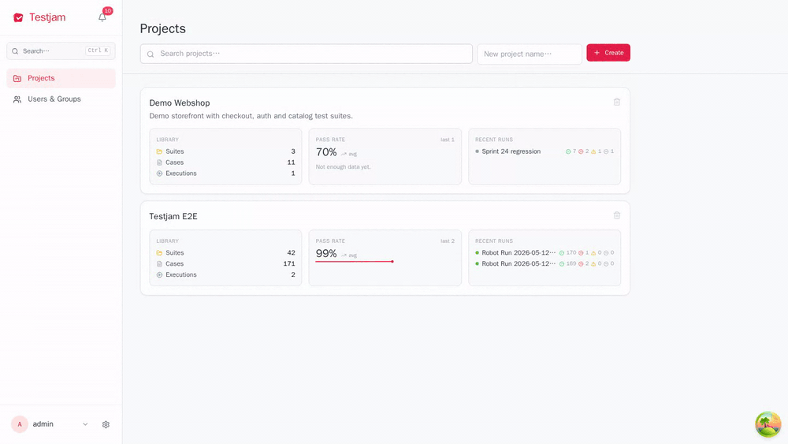

<div align="center">


# Testjam

**Self-hosted test management for teams that ship.**
Plan suites, drive manual runs with keyboard shortcuts, stream CI results live, and export self-contained HTML reports.

[](https://github.com/Jamofer/testjam/actions/workflows/backend.yml)
[](https://github.com/Jamofer/testjam/actions/workflows/testjam-client.yml)
[](https://github.com/Jamofer/testjam/actions/workflows/frontend.yml)
[](https://github.com/Jamofer/testjam/actions/workflows/e2e.yml)

<p align="center">
  
</p>

</div>

---

## Highlights

|                     |                                                                                                       |
|---------------------|-------------------------------------------------------------------------------------------------------|
| 📚 **Library**      | Projects → nested suites → cases with steps, preconditions, tags, attachments                         |
| 🎯 **Plans**        | Curate cases from many suites into versioned plans                                                    |
| ▶️ **Run**           | Manual runs with `j/k` nav + `p/f/b/n` to set status — under a second per case                        |
| 📡 **Live**         | WebSocket stream of step status + logs from CI via `testjam-listener`                                 |
| 📥 **Import**       | JUnit and Robot Framework XML, matched by `external_id` or name                                       |
| 📄 **Reports**      | Self-contained HTML, attachments inlined as data URLs                                                 |
| 🐞 **Bug tracker**  | Native bugs with severity, status workflow, comments, watchers, audit timeline, release notes         |
| 🔌 **Integrations** | Push bugs to GitHub, Jira, GitLab, Azure DevOps, OpenProject + outbound event webhooks                |
| 💬 **Mentions**     | Cross-entity references between users, bugs, runs and cases with email + in-app notifications         |
| 🐍 **Python SDK**   | `pip install testjam-client` — full API coverage for custom CI integration, dashboards and scripting  |
| 💻 **CLI**          | `pip install "testjam-client[cli]"` — `testjam` binary with profiles, REPL, JSON output, `run tail`   |


<details>
<summary><strong>Stack</strong></summary>

| Layer    | Tech                                                    |
|----------|---------------------------------------------------------|
| Backend  | FastAPI · SQLAlchemy (sync) · Alembic · PostgreSQL 18   |
| Frontend | React 18 · Vite · TanStack Query · Tailwind · Radix UI  |
| Auth     | JWT Bearer + scoped API tokens (`X-API-Key`)            |
| Tests    | pytest · Vitest · Robot Framework (E2E)                 |
| Runtime  | Docker Compose                                          |

</details>

---

## Quick start

```bash
cp .env.example .env
# edit .env: set POSTGRES_PASSWORD and SECRET_KEY=$(openssl rand -hex 32)

docker compose up -d
docker compose exec api python scripts/create_admin.py \
  --username admin --email admin@example.com --password secret
```

Open `http://localhost:8080` and sign in. API docs at `http://localhost:8080/api/docs`.

Three containers: `db` (Postgres 18), `api` (FastAPI + uvicorn), `web` (nginx + built frontend). Only `APP_PORT` (default `8080`) is exposed to the host.

---

## Documentation

Full user manual, SDK reference, CLI guide, and architecture overview live in **[`docs/`](docs/README.md)**.

| Section | What you'll find |
|---------|------------------|
| [Getting started](docs/manual/getting-started.md) | Deploy, first admin, sign in |
| [User manual](docs/manual/README.md) | All features end-to-end |
| [Python SDK](docs/manual/sdk.md) | `testjam-client` setup, examples, auth |
| [`testjam` CLI](docs/manual/cli.md) | Shell commands, profiles, REPL |
| [Robot listener](docs/manual/robot-listener.md) | Stream CI results live |
| [Architecture](docs/architecture.md) | Backend + frontend structure for contributors and LLMs |
| [Members & tokens](docs/manual/members-and-tokens.md) | Roles, permissions, API keys |
| [Administration](docs/manual/admin.md) | Backups, restore, instance settings |

---

## Development

```bash
export COMPOSE_FILE=docker-compose-dev.yml
docker compose up
docker compose exec api python scripts/create_admin.py \
  --username admin --email admin@example.com --password secret
```

UI on http://localhost:5173 · API on http://localhost:8000/api/docs

```bash
make test                # all suites
make test-api            # pytest (backend)
make test-front          # vitest (frontend)
make test-e2e            # Robot Framework (parallel)
```

See [`docs/architecture.md`](docs/architecture.md) for project structure and conventions.

---

## History

Testjam began in April 2019 as a sandbox — the first commit landed under the name `pyjam` and was renamed to `testjam` a week later. The intent was to scratch a personal itch: a clean, self-hosted test management tool that wasn't a 2010-era PHP install or a SaaS lock-in. Real life made shipping it alone unrealistic. The bug tracker, the realtime layer, the SDK, the i18n, the Robot Framework listener, the CI orchestrator — each one a side quest, all of them dragging the calendar out of reach. The repository sat dormant for years.

What changed was the arrival of LLMs capable of pair-programming at design speed. The full feature surface visible here was iterated and shipped during one focused stretch with AI assistance, turning a six-year-old prototype into a v1.0 release.

### On the name

**Testjam** here refers strictly to this open-source repository — the self-hosted test management tool documented above. The name was chosen for this codebase in April 2019 and the project is unaffiliated with anything else that may happen to share it. If you arrived here looking for a different product that uses the same name, you're in the wrong place.
